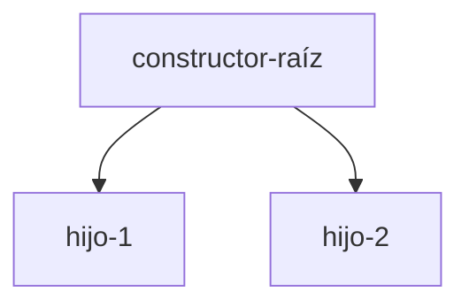
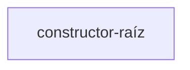
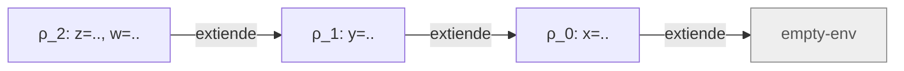
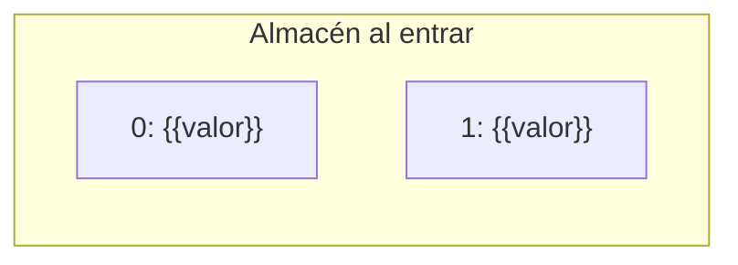
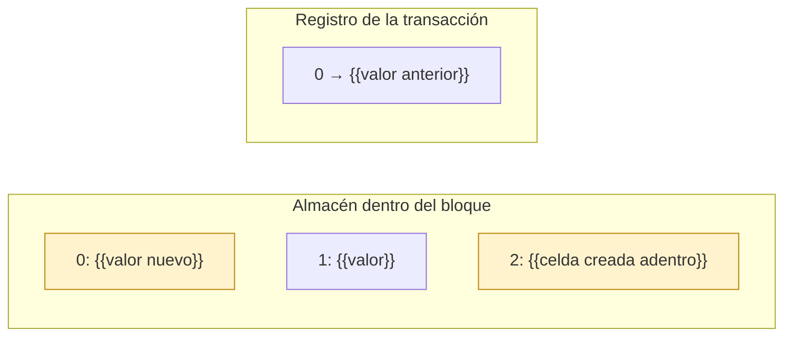
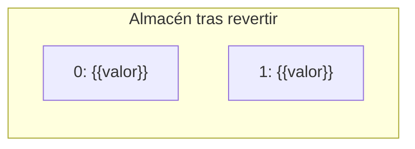

# Informe de AST — {{Nombre del taller / entrega}}

> **Plantilla de entrega.** Copie este archivo a `docs/informe-ast.md`
> dentro del repositorio del grupo y reemplace los marcadores
> `{{...}}` con su contenido. **No elimine las secciones
> obligatorias.** No se aceptan PDF, DOCX ni imágenes insertadas:
> todo el documento debe ser Markdown, las fórmulas en LaTeX
> (`$...$` / `$$...$$`) y los diagramas en Mermaid.

**Curso:** Fundamentos de Interpretación y Compilación de Lenguajes
de Programación — Universidad del Valle, Sede Tuluá.

**Integrantes del grupo:**

| Nombre | Código | Correo institucional |
|--------|--------|----------------------|
| Adriana Milena Noscue Dagua | 2477336 | adriana.noscue@correounivalle.edu.co |
| Sebastian Cucalon Astorquiza | 2477344 | sebastian.cucalon@correounivalle.edu.co |
| Santiago Torres Rojas | 2380301 | santiago.torres.rojas@correounivalle.edu.co |
| Nicolle Camila Hoyos Puin | 2380608 | nicolle.hoyos@correounivalle.edu.co |		

---

## 1. Gramática considerada

Transcriba aquí la gramática BNF del lenguaje / estructura sobre la
cual se construyen los AST. Indique los nombres de los constructores
del datatype.

```bnf
<no-terminal> ::= ...
                constructor-1(campo-1, campo-2)
              ::= ...
                constructor-2(campo-1)
```

---

## 2. Ejemplos de AST

> Incluya **al menos el número de ejemplos solicitados por el
> enunciado**. Cada ejemplo debe presentar:
>
> 1. La expresión concreta (código fuente del lenguaje).
> 2. El AST representado como diagrama **Mermaid** (`graph TD` o
>    `flowchart TD`). Cada nodo debe estar etiquetado con el nombre
>    del constructor del AST (`let-exp`, `prim-exp`, `lit-exp`,
>    `var-exp`, etc.) y sus hijos conectados con aristas dirigidas.
> 3. Una breve explicación de la estructura obtenida.

### Ejemplo 1 — {{descripción corta}}

**Expresión concreta:**

```scheme
{{expresión del lenguaje}}
```

**AST:**



**Explicación:** {{breve descripción de qué nodos se generan y por
qué; si hay subexpresiones anidadas, mencionarlas.}}

---

### Ejemplo 2 — {{descripción corta}}

**Expresión concreta:**

```scheme
{{expresión del lenguaje}}
```

**AST:**



**Explicación:** {{...}}

---

### Ejemplo 3 — {{descripción corta}}

**Expresión concreta:**

```scheme
{{expresión del lenguaje}}
```

**AST:**

```mermaid
graph TD
  %% ...
```

**Explicación:** {{...}}

---

## 3. Traza de evaluación (si la pide el enunciado)

> Si el enunciado incluye un ejercicio de traza de evaluación
> (típicamente en la notación $\textit{value-of}$ de EOPL), complete
> esta sección. Cada paso debe mostrar la expresión evaluada, el
> ambiente y el resultado intermedio.

**Expresión a evaluar:**

```scheme
{{expresión}}
```

**Ambiente inicial:** $\rho_0 = [\,x = v_1,\ y = v_2,\ \ldots\,]$.

**Pasos de la traza:**

1. $\text{value-of}(\{{\text{expr}}\},\, \rho_0)$
2. $\quad \rightarrow \ldots$
3. $\quad \rightarrow \{{\text{resultado final}}\}$

**Diagrama de la cadena de ambientes** (obligatorio — usar Mermaid,
incluir siempre el ambiente vacío al final, flechas del ambiente que
extiende hacia el ambiente extendido):



---

## 4. Estado del almacén en una transacción (si la pide el enunciado)

> Si el lenguaje tiene almacén y bloques transaccionales, incluya al
> menos un ejemplo con el almacén dibujado en tres momentos: antes de
> entrar al bloque, dentro de él con las escrituras hechas, y después
> de revertir. Cada celda va con su posición y su contenido, y el
> registro de la transacción con el valor anterior de cada celda que
> el bloque escribió.

**Programa:**

```text
{{programa con un bloque atomic que aborta}}
```

**Antes de entrar al bloque:**



**Dentro del bloque, con las escrituras hechas:**



**Después de revertir:**



**Explicación:** {{qué escribió el bloque, qué guardó el registro, y por
qué el almacén tras revertir es idéntico al de antes: las celdas
escritas recuperan su valor anterior y las creadas adentro
desaparecen.}}

---

## 5. Referencias

- Friedman, D. P., & Wand, M. *Essentials of Programming Languages*,
  3.ª ed., MIT Press, 2008. Secciones {{…}} (ASTs),
  {{…}} (ambientes).
- {{Otras referencias que hayan consultado.}}
