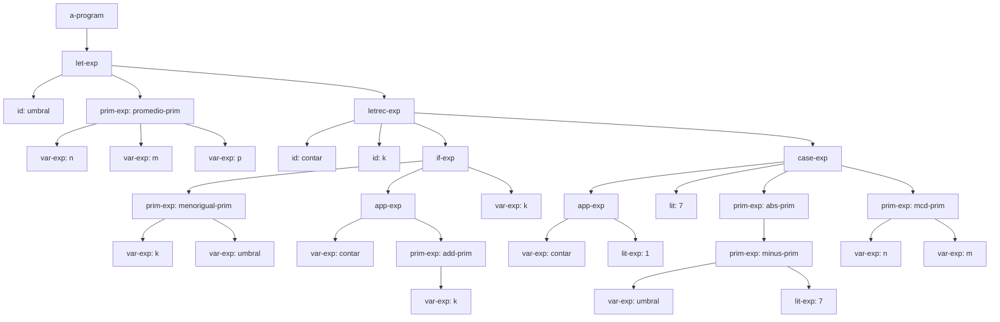
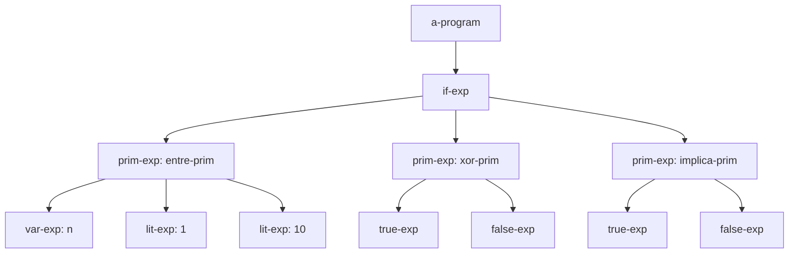
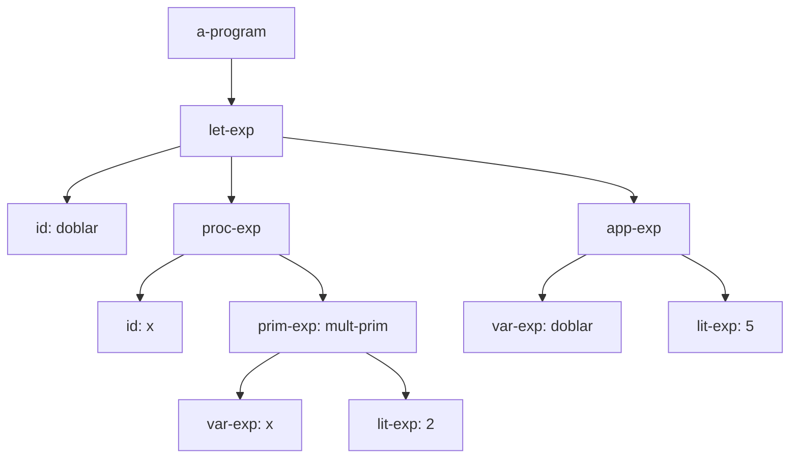
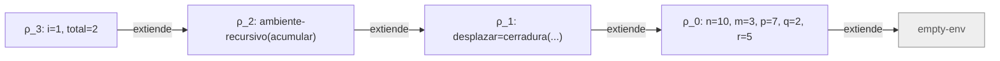

# Informe de AST — Taller 2: El intérprete de Cauca

> **Plantilla de entrega.** Copie este archivo a `docs/informe-ast.md`
> dentro del repositorio del grupo y reemplace los marcadores
> `{{...}}` con su contenido. **No elimine las secciones
> obligatorias.** No se aceptan PDF, DOCX ni imágenes insertadas:
> todo el documento debe ser Markdown, las fórmulas en LaTeX
> (`$...$` / `$$...$$`) y los diagramas en Mermaid.

**Curso:** Fundamentos de Interpretación y Compilación de Lenguajes
de Programación — Universidad del Valle, Sede Tuluá.

**Integrantes del grupo:**

| Nombre | Código | Correo institucional |
|--------|--------|----------------------|
| Adriana Milena Noscue Dagua | 2477336 | adriana.noscue@correounivalle.edu.co |
| Sebastian Cucalon Astorquiza | 2477344 | sebastian.cucalon@correounivalle.edu.co |
| Santiago Torres Rojas | 2380301 | santiago.torres.rojas@correounivalle.edu.co |
| Nicolle Camila Hoyos Puin | 2380608 | nicolle.hoyos@correounivalle.edu.co |		

apply
---

## 1. Gramática considerada

La gramática en forma BNF para el lenguaje **Cauca** que genera el Árbol de Sintaxis Abstracta (AST) 
a través de SLLGEN es la siguiente:

```bnf
<programa>  ::= <expresion>
                a-program (exp)

<expresion> ::= <numero>
                lit-exp (dato)
            ::= <identificador>
                var-exp (id)
            ::= "true"
                true-exp ()
            ::= "false"
                false-exp ()
            ::= <primitiva> "(" {<expresion>}*(,) ")"
                prim-exp (prim, rands)
            ::= "if" <expresion> "then" <expresion> "else" <expresion> "end"
                if-exp (test, true-exp, false-exp)
            ::= "let" {<identificador> "=" <expresion>}* "in" <expresion> "end"
                let-exp (ids, rands, body)
            ::= "proc" "(" {<identificador>}*(,) ")" <expresion> "end"
                proc-exp (ids, body)
            ::= "apply" <expresion> "(" {<expresion>}*(,) ")"
                app-exp (rator, rands)
            ::= "letrec" {<identificador> "(" {<identificador>}*(,) ")" "=" <expresion>}* "in" <expresion> "end"
                letrec-exp (proc-names, idss, bodies, body)
            ::= "case" <expresion> {"of" <numero> "=>" <expresion>}+ "otherwise" "=>" <expresion> "end"
                case-exp (exp, valores, acciones, default)
```

---

## 2. Ejemplos de AST

> Incluya **al menos el número de ejemplos solicitados por el
> enunciado**. Cada ejemplo debe presentar:
>
> 1. La expresión concreta (código fuente del lenguaje).
> 2. El AST representado como diagrama **Mermaid** (`graph TD` o
>    `flowchart TD`). Cada nodo debe estar etiquetado con el nombre
>    del constructor del AST (`let-exp`, `prim-exp`, `lit-exp`,
>    `var-exp`, etc.) y sus hijos conectados con aristas dirigidas.
> 3. Una breve explicación de la estructura obtenida.

### Ejemplo 1 — Árbol de Sintaxis Abstracta del programa de prueba

**Expresión concreta:**

```scheme
let umbral = promedio(n, m, p)
in
  letrec
    contar (k) = if <=(k, umbral)
                 then apply contar (add1(k))
                 else k
                 end
  in
    case apply contar (1)
      of 7 => abs(-(umbral, 7))
      otherwise => mcd(n, m)
    end
  end
end
```

**AST:**



**Explicación:** El nodo raíz a-program contiene un let-exp que liga umbral al resultado de prim-exp (promedio-prim). Su cuerpo contiene un letrec-exp que define el procedimiento recursivo contar mediante un if-exp. El cuerpo del letrec es un case-exp cuya expresión de control es una aplicación de procedimiento (app-exp) de contar sobre el literal 1, con sus respectivas ramas of 7 y otherwise.

---

### Ejemplo 2 — Primitivas Booleanas y Rango (Parte 2)

**Expresión concreta:**

```scheme
if entre(n, 1, 10)
then xor(true, false)
else implica(true, false)
end
```

**AST:**



**Explicación:** Muestra el árbol de sintaxis para un condicional if-exp que evalúa la primitiva ternaria de rango entre-prim sobre la variable n y los límites 1 y 10. Las ramas del condicional contienen aplicaciones de las primitivas lógicas de la Parte 2: xor-prim e implica-prim aplicadas sobre literales booleanos.

---

### Ejemplo 3 — Procedimientos y Orden Superior (Parte 3)

**Expresión concreta:**

```scheme
let doblar = proc (x) *(x, 2) end
in
  apply doblar (5)
end
```

**AST:**



**Explicación:** El constructor let-exp asigna a la variable doblar una expresión de creación de procedimiento proc-exp con parámetro x y cuerpo mult-prim. En el cuerpo del let, el constructor app-exp representa la aplicación del procedimiento doblar pasando el argumento literal 5.

---

## 3. Traza de evaluación (si la pide el enunciado)

> Si el enunciado incluye un ejercicio de traza de evaluación
> (típicamente en la notación $\textit{value-of}$ de EOPL), complete
> esta sección. Cada paso debe mostrar la expresión evaluada, el
> ambiente y el resultado intermedio.

**Expresión a evaluar:**

```scheme
let desplazar = proc (x, d) +(x, d) end
in
  letrec
    acumular (i, total) = if <=(i, m)
                          then total
                          else apply acumular (add1(i), apply desplazar (total, i))
                          end
  in
    apply acumular (1, q)
  end
end
```

**Ambiente inicial:** $\rho_0 = [\,n = 10,\ m = 3,\ p = 7,\ q = 2,\ r= 5]$.

**Pasos de la traza:**

1. $\text{value-of}(\text{let desplazar} = \text{proc}(x, d)\dots, \rho_0)$
Se evalúa la creación de la clausura: $v_{desplazar} = \text{cerradura}([x, d], +(x, d), \rho_0)$
Se extiende el ambiente: $\rho_1 = [desplazar = v_{desplazar}]\,\rho_0$
2. $\text{value-of}(\text{letrec acumular}(i, total)\dots, \rho_1)$
Se construye el ambiente recursivo: $\rho_2 = \text{ambiente-recursivo}(\text{proc-names}=[acumular], \text{idss}=[[i, total]], \text{bodies}=[\text{if}\dots], \text{env}=\rho_1)$
3. $\text{value-of}(\text{apply acumular (1, q)}, \rho_2)$
$\text{value-of}(1, \rho_2) \to 1$$\text{value-of}(q, \rho_2) \to 2$Búsqueda en el ambiente: $\text{apply-env}(\rho_2, acumular) \to v_{acumular} = \text{cerradura}([i, total], \text{body}_{acumular}, \rho_2)$Extensión del ambiente para la invocación: $\rho_3 = [i = 1, total = 2]\,\rho_2$
4. $\text{value-of}(\text{body}_{acumular}, \rho_3)$
Evaluación del condicional: $\text{value-of}(\le(i, m), \rho_3) \to \le(1, 3) \to \mathbf{true}$Selección de la rama then: $\text{value-of}(total, \rho_3) \to \mathbf{2}$
5. $\quad \rightarrow 2$

**Diagrama de la cadena de ambientes** (obligatorio — usar Mermaid,
incluir siempre el ambiente vacío al final, flechas del ambiente que
extiende hacia el ambiente extendido):



---

## 4. Estado del almacén en una transacción (si la pide el enunciado)

> Si el lenguaje tiene almacén y bloques transaccionales, incluya al
> menos un ejemplo con el almacén dibujado en tres momentos: antes de
> entrar al bloque, dentro de él con las escrituras hechas, y después
> de revertir. Cada celda va con su posición y su contenido, y el
> registro de la transacción con el valor anterior de cada celda que
> el bloque escribió.

Nota: La especificación de la gramática del lenguaje Cauca es de naturaleza puramente funcional y no incluye estados de memoria explícitos ni bloques transaccionales (atomic). Por lo tanto, esta sección no aplica para la arquitectura del intérprete implementado en este taller.

---

## 5. Referencias

- Friedman, D. P., & Wand, M. *Essentials of Programming Languages*,
  3.ª ed., MIT Press, 2008. Secciones Sección 3.2 (ASTs),
  Sección 3.3 (procedimientos y clausuras) y Sección 3.4 (ambientes).

